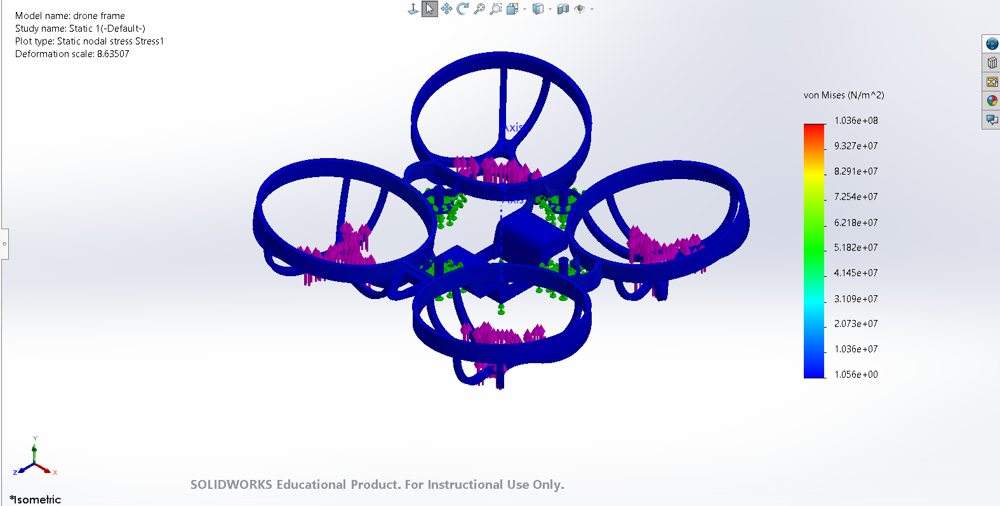
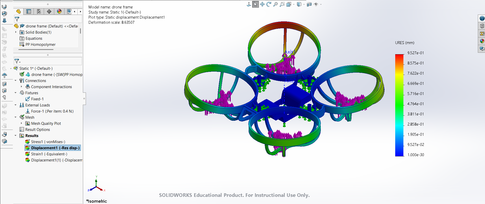
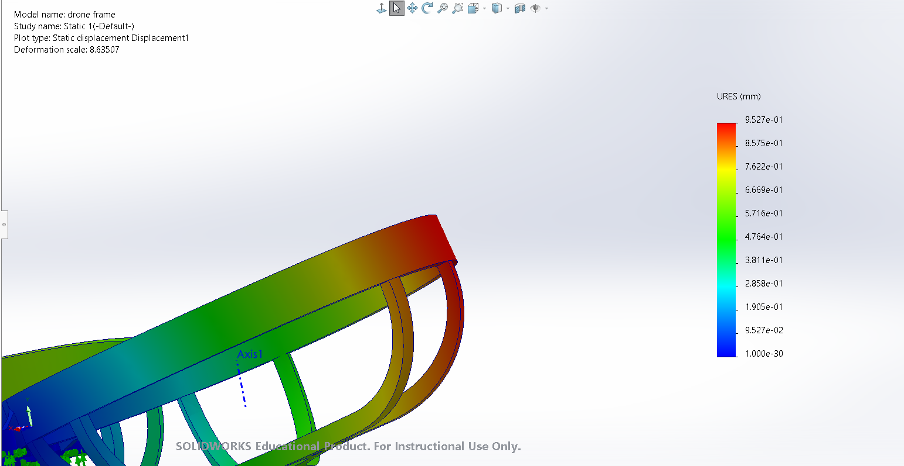

# 65mm-Micro-Drone-Reverse-Engineering-FEA
# 65mm Micro-Whoop Airframe: Reverse Engineering & FEA Material Optimization

## Project Overview
Standard 65mm micro-drone frames are injection-molded from **Polypropylene (PP) Homopolymer** for impact flexibility. However, excessive frame compliance under motor thrust introduces mid-air resonance, degrading flight controller PID loop performance. 

This project reverse-engineers a 65mm ducted airframe from a reference mesh in **SolidWorks** to evaluate structural deflection under maximum static thrust and investigate a material upgrade to **3D-Printed Carbon Fiber Reinforced Nylon (PA-CF)**.

## Methodology & Simulation Setup

### 1. Reverse Engineering (CAD)
* Reconstructed parametric solid geometry over a reference STL stencil using boss extrusions, circular patterns, and multi-body boolean operations (`Combine`).
* Optimized thin-wall strut intersections (~1.0 mm thickness) to eliminate zero-thickness sliver faces prior to discretization.

### 2. Material Definition
Compared baseline factory thermoplastics against a custom-defined composite filament library:

| Material Property | Baseline: PP Homopolymer | Upgrade: PA-CF (Carbon Fiber Nylon) |
| :--- | :--- | :--- |
| **Elastic Modulus** | ~1,500 MPa | 6,000 MPa |
| **Poisson's Ratio** | 0.41 | 0.35 |
| **Shear Modulus** | ~530 MPa | 2,200 MPa |
| **Mass Density** | 900 kg/m³ | 1,150 kg/m³ |
| **Yield Strength** | ~30 MPa | 65 MPa |

### 3. Boundary Conditions & Meshing
* **Fixtures:** Fixed geometry applied to the central battery bay and lower flight controller standoff bases to simulate the aircraft's center of mass in a hover.
* **External Loads:** `0.4 N` upward normal force applied *per item* across all four 3-pronged motor mounting pads (1.6 N total vertical thrust).
* **Mesh Parameters:** Blended curvature-based mesh (`1.5 mm` max, `0.3 mm` min) to resolve thin-wall strut geometry and bypass sharp-edge failures on the ducts.

## Baseline Results & FEA Root-Cause Analysis

### Model Validation & Anomaly Diagnosis
In the initial baseline PP Homopolymer static study, the frame was analyzed for von Mises Stress distribution and overall displacement under load.

While inspecting the displacement plot, an asymmetrical deflection spike of **0.953 mm (`9.527e-01 mm`)** was identified, isolated entirely to the top-right duct quadrant.

**Engineering Findings:**
1. **Boundary Discontinuity:** Inspection of the deformed mesh boundary showed that the outer duct ring and inner support strut did not share contiguous nodes across the interface. 
2. **Knife-Edge Geometry in Meshing:** Tracing the issue back to the feature tree revealed that tangent edge-to-edge sketching created microscopic sliver faces (`<0.01 mm`) during the boolean `Combine` operation, causing the solver to treat the outer ring as partially unrestrained.

## Future Work & Physical Prototyping Roadmap 
* **CAD Overlap Revision:** Refactor the master strut sketches to deeply penetrate the inner duct walls before executing the boolean `Combine`, ensuring 100% node merging across all four quadrants.
* **PA-CF Comparative Study:** Execute the duplicated static study with the custom PA-CF material profile to quantify the exact percentage reduction in vertical duct deflection.
*  **FDM Manufacturing & Flight Testing:** Slice and 3D-print the revised airframe in PA-CF, transfer brushless motors and flight controller hardware, and compare Blackbox gyro noise logs against the stock PP frame.
